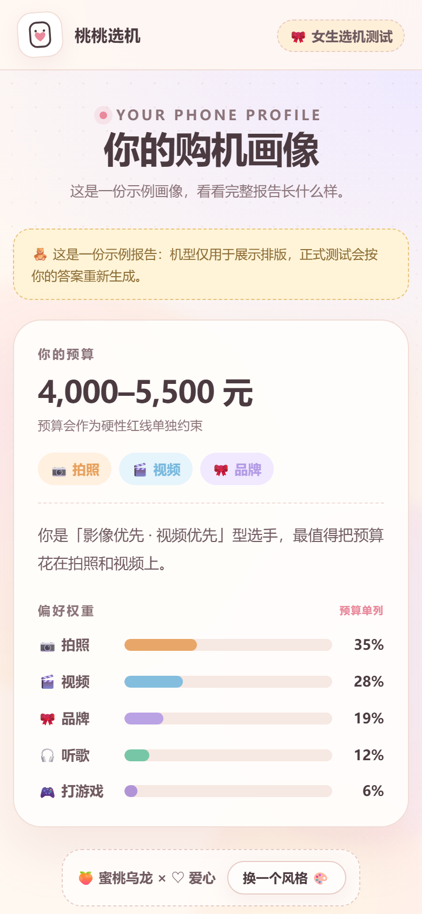
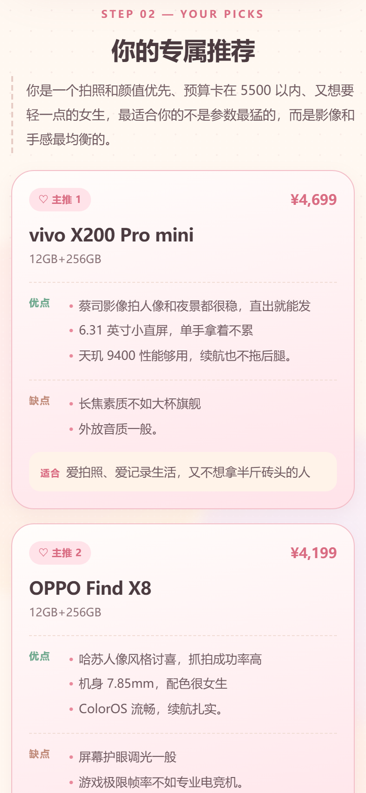
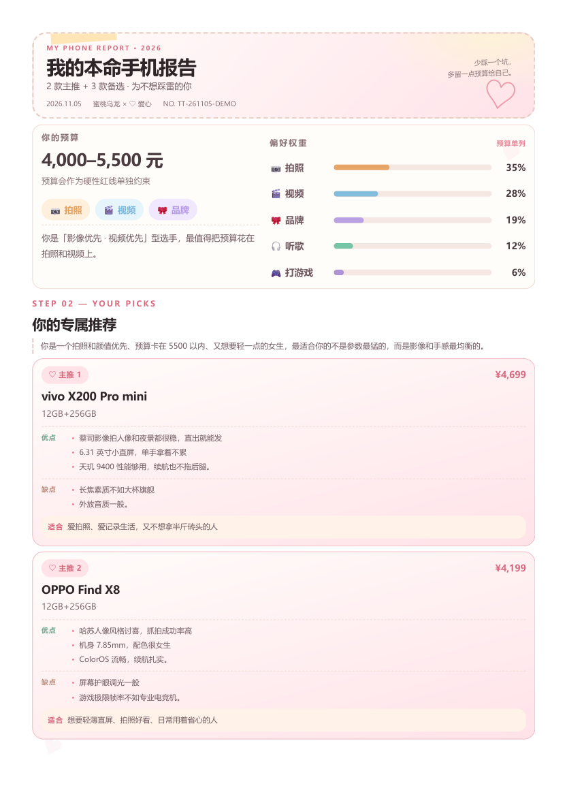
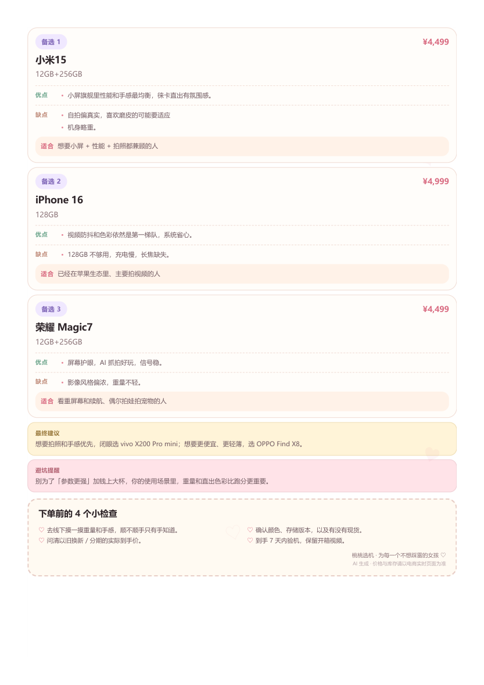
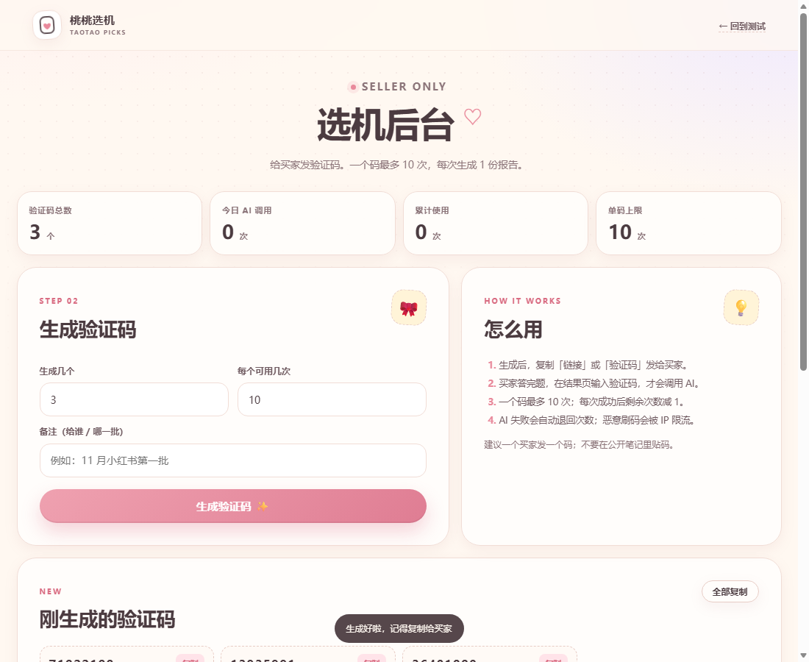

# 桃桃选机 · 本命手机测试 v2

小红书手机测试站：**排序 → 动态答题 → 购机画像 → 验证码解锁 DeepSeek 报告 → 可爱 PDF**。

DeepSeek 的 key 只在后端；验证码由卖家后台生成，**一个码默认最多用 10 次**；前端不暴露 key，也不允许直接塞 prompt。









## 这一版有什么

- **19–22 道题**（含第 1 题排序），题库 25 题，硬上限 30。
- 第 1 题固定排序：价格、品牌、视频、拍照、听歌、打游戏。
- 价格有**内部保底权重**：无论排第几，价格都不会掉出前三；页面上把价格拆成「预算约束」，不把保底规则暴露给买家。
- **DeepSeek 单次调用**：一次请求只返回最终报告，不展示思考过程，不返回原始长文。
- **验证码额度**：8 位数字，默认一码 10 次，每次生成 1 份报告；AI 失败自动退回次数。
- **卖家后台**：`/admin`，输管理员密码后可批量发码、复制链接、查看剩余次数、停用。
- **5 × 5 = 25 种风格**：5 套配色 × 5 种装饰元素；报告页可「换一个风格」，PDF 跟随当前风格。
- **可爱 PDF**：浏览器打印 / 存 PDF，2 页 A4；封面、预算、权重、2 主推、3 备选、最终建议、避坑、下单检查清单。
- **防刷**：IP 限流、每日全站额度、验证码 TTL、幂等请求、请求体校验、来源校验、CSP、静态文件白名单。
- 示例报告：`/?demo=1`；算法调试：`/?debug=1`。

## 快速开始

要求 Node.js **20.6+**（没有第三方依赖，不需要 `npm install` 也可以跑）。

```powershell
cd D:\user_chengjie\XHS_PRJ
Copy-Item .env.example .env
# 打开 .env，填 DEEPSEEK_API_KEY 和 ADMIN_TOKEN
node server.js
```

也可以直接双击根目录的 `start.bat`：第一次会创建 `.env` 并打开记事本，填好 key 和后台密码后再运行一次就行。

> 直接双击 `index.html` 只能看首页和 `?demo=1` 示例报告；真实生成必须经过 `server.js`，否则页面会提示你先启动后端。

> Windows PowerShell 里如果 `npm` 被脚本执行策略拦住，用 `npm.cmd start`，或者直接 `node server.js`。

打开：

- 买家端：<http://localhost:3000>
- 卖家后台：<http://localhost:3000/admin>
- 示例报告：<http://localhost:3000/?demo=1>

> `.env` 已被 `.gitignore` 忽略。**不要把 key 发到聊天、截图或前端代码里**；只放在服务器的环境变量或 `.env`。

### 生成一个管理员密码

```powershell
node -e "console.log(require('crypto').randomBytes(24).toString('base64url'))"
```

把输出填到 `.env` 的 `ADMIN_TOKEN`。

## 验证码怎么发

1. 打开 `/admin`，输入 `ADMIN_TOKEN`。
2. 设置生成数量、每个码可用次数（1–10），点「生成验证码」。
3. 复制「链接」（`https://你的域名/?code=48271936`）或验证码，私信发给买家。
4. 买家答完题 → 输入验证码 → 生成报告；成功后剩余次数减 1。
5. 失败（AI 超时 / 格式没写完整）会自动退回次数；输错码、过期、停用不会生成。
6. 一个码最多 10 次；建议一个买家一个码，不要在公开笔记里贴码。

验证码默认 30 天过期（`CODE_TTL_DAYS`），后台可以提前停用。

## 配置项

复制 `.env.example` 为 `.env`：

| 变量 | 说明 | 默认 |
|---|---|---|
| `DEEPSEEK_API_KEY` | 必填，DeepSeek key，只在服务端 | 空 |
| `ADMIN_TOKEN` | 必填，后台密码，建议 20 位以上随机串 | 空 |
| `PUBLIC_ORIGIN` | 线上域名，例如 `https://phone.example.com` | 请求 Host |
| `DATA_DIR` | 验证码/用量落盘目录 | `./data` |
| `DEEPSEEK_MODEL` | 模型名 | `deepseek-chat` |
| `DEEPSEEK_BASE_URL` | API 地址，测试时可指向 mock | `https://api.deepseek.com` |
| `DEEPSEEK_MAX_TOKENS` | 单次输出上限 | `1800` |
| `DEEPSEEK_TIMEOUT_MS` | 单次超时 | `75000` |
| `MAX_CODE_QUOTA` | 单码最大次数，硬上限 10 | `10` |
| `CODE_TTL_DAYS` | 验证码有效期 | `30` |
| `RATE_MAX` | 同一 IP / `RATE_WINDOW_MIN` 分钟内最多请求 | `12` |
| `RATE_WINDOW_MIN` | 限流窗口（分钟） | `10` |
| `IP_DAILY_MAX` | 同一 IP 每天最多请求（含输错码） | `30` |
| `GLOBAL_DAILY_MAX` | 全站每天最多调用 DeepSeek | `200` |
| `TRUST_PROXY` | 在 Nginx / Render / Railway 后面设为 `1` | `0` |

品牌、联系方式、5 套主题和 5 种元素在 `assets/js/config.js`：

```js
brand: '桃桃选机',
contactUrl: 'https://www.xiaohongshu.com/', // 换成你的主页
themes: [ ... ], // 5 套配色
motifs: [ ... ]  // 5 种元素
```

题库在 `assets/js/questions.js`，Prompt 在 `assets/js/engine.js` 的 `buildPrompt()`。

## 部署

这是 **Node 服务**，不是纯静态站。API 必须和页面部署在同一个域名下，才能调用 `/api/generate`。

> Netlify / Vercel 的纯静态托管只能看首页和示例报告，**不能生成真实报告**。要用 Node 托管（Render / Railway / Fly / 自己的 VPS / Docker）。

### Render（推荐新手，已带 render.yaml）

1. 把项目传到一个 GitHub 仓库（网页上传即可，**不要把 `.env` 传上去**）。
2. Render → New → **Blueprint**，选这个仓库；它会自动读取 `render.yaml`。
3. 按提示填两个 Secret：`DEEPSEEK_API_KEY`、`ADMIN_TOKEN`；点 Apply。
4. 等部署完成，复制 Render 给的 `https://xxx.onrender.com`。
5. 打开 `https://xxx.onrender.com/admin`，用 `ADMIN_TOKEN` 登录、生成验证码。
6. 可选：在 Render 环境变量里加 `PUBLIC_ORIGIN=https://xxx.onrender.com`，后台生成的链接会更稳。

`render.yaml` 里已经配好：
- Node、`npm start`
- 持久盘 `/var/data`（验证码不会因重启丢失）
- `TRUST_PROXY=1`
- 单码 10 次、30 天过期、IP 限流、全站日额度

> 持久盘和 `starter` 实例是付费的（大约每月几美元 + 磁盘）。免费实例没有持久盘，验证码重启会丢，正式卖不建议。

> 免费实例可能没有持久盘；验证码存在 `data/codes.json`，没有持久盘重启会丢，正式卖建议用带磁盘的付费实例。

### Railway

1. New Project → Deploy from GitHub。
2. Variables 里填 `.env`；加 Volume，Mount Path `/data`，`DATA_DIR=/data`。
3. `TRUST_PROXY=1`，`PUBLIC_ORIGIN` 填 Railway 域名。

### Docker / VPS

```powershell
docker build -t taotao-phone .
docker run -d --name taotao-phone `
  -p 3000:3000 `
  --env-file .env `
  -v taotao-data:/data `
  taotao-phone
```

Nginx 反代到 `127.0.0.1:3000`，配 HTTPS；服务端设 `TRUST_PROXY=1`、`PUBLIC_ORIGIN=https://你的域名`。

### 为什么不建议 serverless

验证码额度要跨请求持久化；本项目用本地 JSON 文件，**单实例**简单可靠。Vercel / Netlify Functions 每次冷启动文件系统不共享，会超发，不建议直接套。

## 价格权重怎么处理

内部仍保留六维权重和隐藏保底：

- 基础权重：28 / 23 / 19 / 15 / 10 / 5
- 价格排第 4–6 时，先抬到 `19 + 3 = 22`，归一化后如果取整仍掉出前三，就从最低维度挪 1 个点，直到严格进前三。
- 720 种排序全部测试：六维合计 100，价格永远前三。

但页面 **不展示价格的权重数字**，而是把它拆成「预算」：

- 偏好权重只展示拍照、视频、品牌、听歌、游戏 5 项，重新归一化到 100%。
- 价格作为预算约束：有明确预算时是硬红线；选「没有硬预算」时提醒 AI 不要推荐明显溢价机型。
- Prompt 里还会写「价格排第 N 位」，让 AI 知道她是能省则省，还是预算内选体验更好的。
- 卖家可用 `/?debug=1` 看内部六维权重。

这样买家不会看到「我把价格排最后，价格怎么还这么高」，但价格永远不会被忽略。

## 5 × 5 风格与 PDF

- 5 套配色：蜜桃乌龙、抹茶奶盖、芋泥波波、海盐苏打、焦糖布丁。
- 5 种元素：爱心、星星、小花、云朵、蝴蝶结。
- 每份报告随机选一个组合；结果页「换一个风格 🎨」按 25 个组合循环。
- PDF 跟随当前风格：A4 两页，第一页封面 + 预算 + 权重 + 2 主推；第二页 3 备选 + 最终建议 + 避坑 + 下单检查清单。
- 打印使用浏览器原生「打印 / 存 PDF」，中文字体不用额外打包，也不会糊。

## 防刷设计

已经做的：

- **key 只在服务端**：前端拿不到 key，也不能传自己的 prompt；服务端只接收结构化答案，自己重建 prompt。
- **验证码**：8 位数字、`MAX_CODE_QUOTA` 硬上限 10、30 天过期、可停用。
- **单次调用**：一个报告只调一次 DeepSeek，`stream:false`，不返回思考过程。
- **额度预占 + 失败退回**：先扣次数再调用；AI 失败、超时、格式不完整自动退回。
- **IP 限流**：默认 12 次 / 10 分钟、30 次 / 天。
- **全站日额度**：默认 200 次/天，保护钱包。
- **幂等**：同一个 `requestId` 3 分钟内重复提交只返回缓存，不重复扣次数、不重复调 API。
- **管理员保护**：`ADMIN_TOKEN` 常量时间比较、后台接口限流、错误密码不泄露信息。
- **输入校验**：只接受 6 个合法维度、合法选项；请求体 48KB 上限；拒绝未知结构。
- **浏览器防护**：同源检查、CSP、`X-Frame-Options`、`nosniff`、`Referrer-Policy`。
- **静态白名单**：只允许 HTML/CSS/JS/预览图，`data/`、`.env`、`server.js`、`lib/`、`tests/` 全部 404。

仍然防不住的：

- 买家把验证码转给别人（一码 10 次，建议一人一码）。
- 攻击者换大量 IP 刷（需要 Cloudflare / 付费 WAF / 更严格的实名或短信验证）。
- 服务端被入侵（key 在环境变量里，记得限制服务器权限、定期换 key）。

## 测试

```powershell
npm.cmd test
```

> 直接 `node tests/engine.test.js && node tests/api.test.js` 也可以。

覆盖：

- `tests/engine.test.js`：720 种排序、权重合计 100、价格保底、总题数 ≤ 30、Prompt 输出格式、AI 回答解析、示例数据。
- `tests/api.test.js`：用 mock DeepSeek 跑真实 `server.js`，测试管理员鉴权、发码、10 次额度、第 11 次拒绝、幂等、错误码、AI 失败退款、静态文件隔离。

当前结果：

```text
题数范围：19–22 题（含排序），价格被抬进前三的排列：360
✅ 全部通过（762 项检查）
✅ API 测试通过（78 项）
```

另外做过 Edge 浏览器端到端：排序 → 答完 20 题 → 输码解锁 → 5 张卡 → 换风格 → 打印 2 页 PDF → 刷新后继续看；390px 无横向溢出。

## 文件结构

```text
XHS_PRJ/
├─ index.html                 买家端
├─ admin.html                 卖家后台
├─ server.js                  Node 服务（静态 + API + 后台）
├─ lib/
│  ├─ ai.js                   DeepSeek 单次调用
│  ├─ store.js                验证码 / 每日用量存储
│  └─ validate.js             服务端答案校验
├─ assets/
│  ├─ css/style.css           基础视觉
│  ├─ css/v2.css              验证码卡 / 5×5 主题 / PDF
│  ├─ css/admin.css           后台
│  └─ js/
│     ├─ config.js            品牌 / 联系方式 / 主题
│     ├─ questions.js         题库
│     ├─ engine.js            权重、出题、Prompt、解析
│     ├─ app.js               买家端交互
│     └─ admin.js             后台交互
├─ tests/                     engine + api 测试
├─ preview/                   README 预览图
├─ Dockerfile
├─ render.yaml               Render 一键部署配置
├─ start.bat                  Windows 双击启动
├─ .env.example
├─ package.json
└─ README.md
```

运行后会自动生成 `data/codes.json`、`data/usage.json`（已在 `.gitignore` 里）。

## 关于「双 AI / 三 AI」

这一版实际只调用 **一次 DeepSeek**。Prompt 会让它先从「体验派」和「实用派」两个视角检查，再合并成唯一结论，所以界面写的是 **AI 双视角**，不是「双 AI」。

这样做是为了：

- 不虚假宣传；
- 一次调用只消耗一次额度，10 次额度真的能用 10 次；
- 速度快，成本低。

如果你坚持要字面上的「双 AI」，需要每次报告调用 2 次 DeepSeek（额度消耗、延迟、费用都会翻倍），可以再改。

## 注意

- 示例机型/价格只用于排版，正式报告由 AI 实时生成。
- AI 价格会出错；结果页和 PDF 都提示「价格以电商实时页面为准」。
- 不要承诺「最准」「最低价」；小红书文案建议写「帮你把需求问清楚，少被参数表带跑」。
- 不收集手机号 / 微信 / 位置；只保存验证码用量和 IP 限流计数。
- 正式卖之前，把 `config.js` 里的 `contactUrl` 换成你的主页，把 `ADMIN_TOKEN` 换成随机长密码，把 `DEEPSEEK_API_KEY` 放进服务器环境变量。

---

Made with ♡ for girls who don't want to buy the wrong phone.
